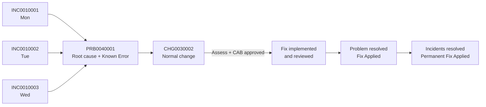
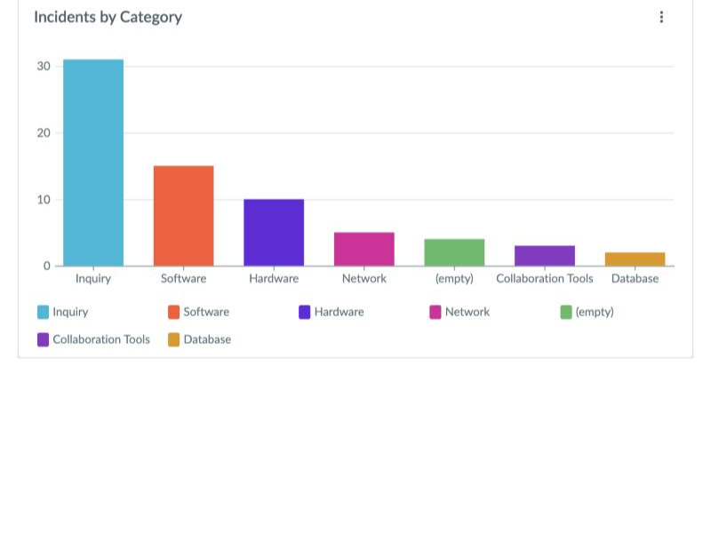
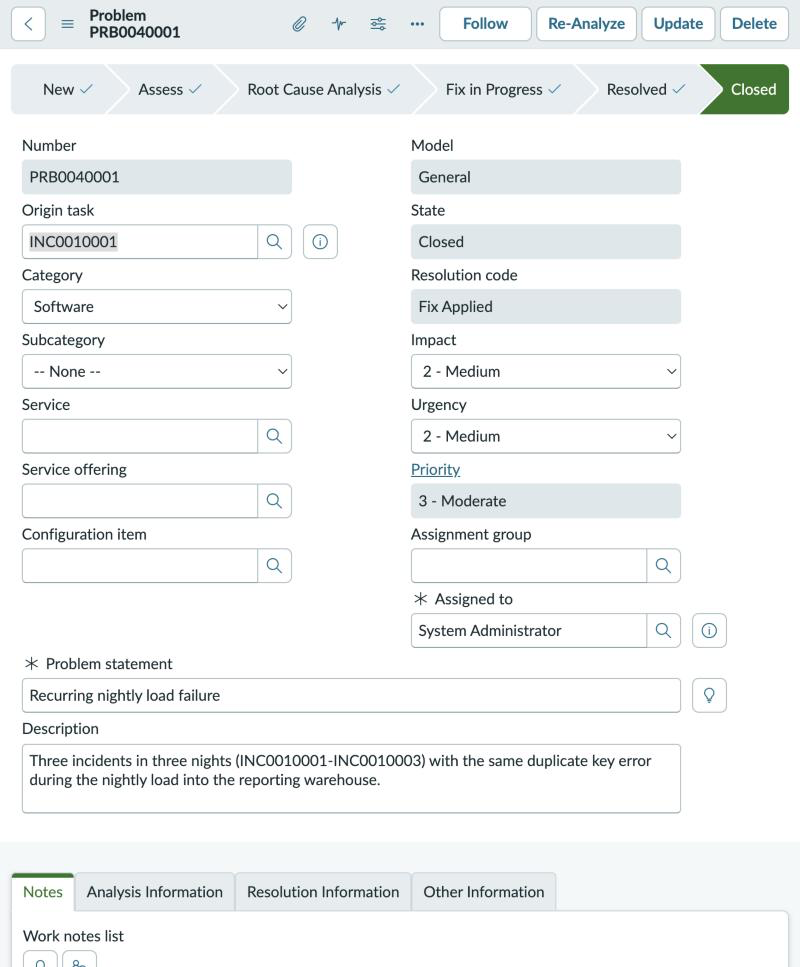
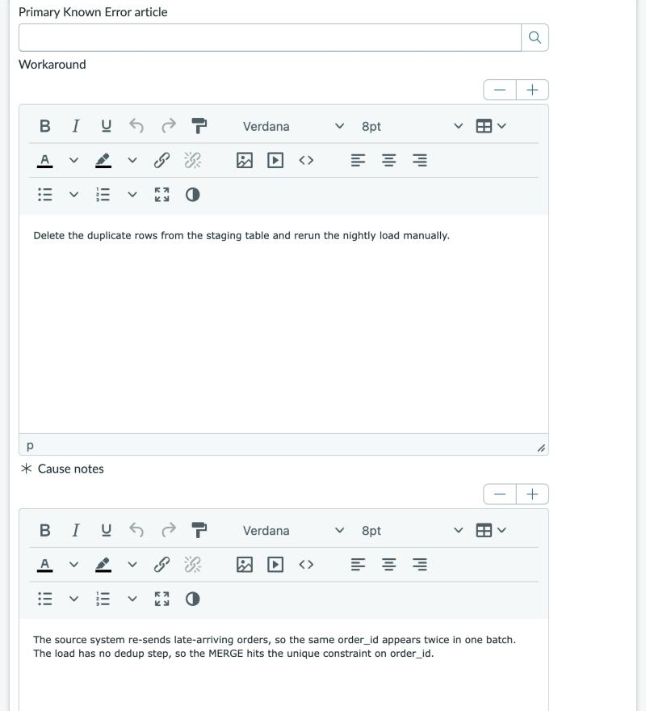
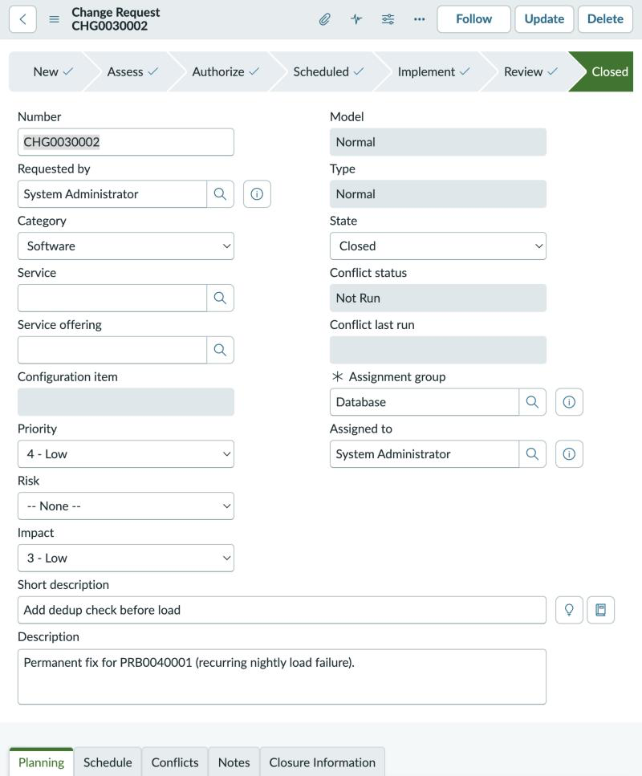

# ServiceNow ITSM: Problem Management Lifecycle

I ran a full ITIL problem management lifecycle in a ServiceNow Personal Developer Instance (Brazil release): three repeat incidents, one problem record taken from detection to closure, a Normal change through two approval stages, and an incident trend dashboard.

The scenario is a practice case I designed around a failure I see in data work: a nightly warehouse load that fails three nights in a row on the same duplicate key error.

## The lifecycle

| Step | Record | What I did |
|---|---|---|
| 1. Detect | INC0010001-0003 | Logged three incidents, one per night, with the same symptom: `duplicate key value violates unique constraint on order_id`. Category Software, impact and urgency 2 (priority 3 - Moderate). |
| 2. Open the problem | PRB0040001 | Opened "Recurring nightly load failure" with INC0010001 as the origin task, assigned it, and moved it from New to Assess to Root Cause Analysis. |
| 3. Root cause | PRB0040001 | The source system re-sends late-arriving orders, so the same `order_id` appears twice in one batch. The load has no dedup step, so the MERGE hits the unique constraint. |
| 4. Known error | PRB0040001 | Logged the workaround (delete duplicate staging rows and rerun the load) and marked the problem as a **Known Error**, so support can restore service while the permanent fix is in progress. |
| 5. Permanent fix | CHG0030002 | Raised a Normal change, "Add dedup check before load", with justification, implementation plan (`ROW_NUMBER()` dedup on `order_id` before the MERGE), backout plan, test plan and risk analysis, and linked it to the problem. |
| 6. Approve and implement | CHG0030002 | Took the change through Assess (Database group approvals) and Authorize (CAB approvals), then Scheduled, Implement, Review and Closed with close code **Successful**. |
| 7. Close out | PRB0040001, INC0010001-0003 | Moved the problem to Fix in Progress, Resolved (**Fix Applied**) and Closed, then resolved each incident with **Resolved - Permanent Fix Applied** and a note pointing to the change and problem. |
| 8. Report | Ops Overview dashboard | Built a Platform Analytics dashboard with an **Incidents by Category** bar chart (Incident table, count grouped by category) to watch for trends and themes. |

## Screenshots

**Ops Overview dashboard: Incidents by Category**

| Problem PRB0040001 (closed, Fix Applied) | Root cause and workaround (Known Error) |
|---|---|
|  |  |

| Change CHG0030002 (Normal, all stages complete) | Incidents INC0010001-0003 (resolved) |
|---|---|
|  |  |

## Design notes

- **Incident to problem link.** This release has no Problem reference field on the incident form, so I tied the records together with the problem's Origin task (INC0010001), the problem description, and work notes on each incident that name PRB0040001.
- **Change approvals.** A Normal change in this release needs two approval rounds: the assignment group approves in Assess, then the CAB approves in Authorize. All approvals are in [`data/records.json`](data/records.json).
- **Dashboard.** Classic reports can't be added to the new Platform Analytics dashboards directly, so I built the chart as a dashboard visualization on the Incident table.

## Proof

- [`data/records.json`](data/records.json): every record exported through the ServiceNow REST Table API (incidents, problem, change, approvals, dashboard definition).
- [`docs/interview_walkthrough.md`](docs/interview_walkthrough.md): how I explain the case in 60 seconds, plus the questions I prepared for.
- [`assets/`](assets): screenshots of the dashboard, problem, change and incidents.

## Skills shown

ServiceNow (Incident, Problem, Change, Platform Analytics) · ITIL problem management · Root cause analysis · Known errors and workarounds · Change Advisory Board (CAB) approvals · Incident trend reporting

## Related

- ServiceNow University: IT Service Management (ITSM) Fundamentals (completed October 2026)
